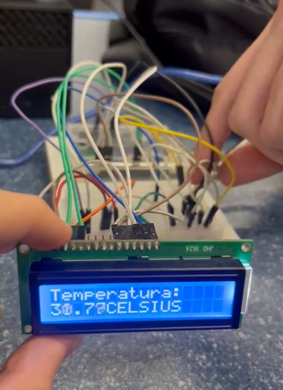

# Termômetro Digital com Arduino e Display LCD 16x2

Projeto de medição de temperatura ambiente em tempo real usando **Arduino**, um **sensor de temperatura LM35** e um **display LCD 16x2**. A leitura é exibida diretamente no display em graus Celsius, com duas casas decimais.


---

## Demonstração
<p align="center">

</p>

---

## Objetivo

Praticar conceitos de eletrônica e programação embarcada, abordando:

- Leitura de sinais analógicos com o conversor ADC do Arduino
- Conversão de tensão em temperatura
- Uso de display LCD em modo paralelo (4 bits)
- Montagem de circuitos em protoboard

--

## Materiais

| Qtd | Componente |
|-----|------------|
| 1 | Arduino (Uno ou compatível) |
| 1 | Sensor de temperatura LM35 |
| 1 | Display LCD 16x2 (JHD 162A / HD44780) |
| 1 | Potenciômetro 10kΩ (ajuste de contraste) |
| 1 | Protoboard |
| — | Jumpers macho-macho |

---

## Ligações

### Display LCD → Arduino

| Pino do LCD | Arduino |
|-------------|---------|
| VSS | GND |
| VDD | 5V |
| V0 | Pino central do potenciômetro |
| RS | D12 |
| RW | GND |
| E | D11 |
| D4 | D5 |
| D5 | D4 |
| D6 | D3 |
| D7 | D2 |
| A (backlight +) | 5V |
| K (backlight −) | GND |

### Sensor LM35 → Arduino

| Pino do LM35 | Arduino |
|--------------|---------|
| 1 (+Vs) | 5V |
| 2 (Vout) | A0 |
| 3 (GND) | GND |

---

## ⚙️ Como funciona

1. O LM35 gera uma tensão de **10 mV para cada 1 °C**.
2. O Arduino lê essa tensão no pino analógico `A0` (valor de 0 a 1023).
3. O código faz a média de 10 leituras para reduzir ruído.
4. O valor é convertido em tensão e depois em graus Celsius:

   ```
   temperatura (°C) = (leitura × 5.0 / 1023.0) × 100
   ```

5. O resultado é mostrado na segunda linha do LCD, atualizado a cada 500 ms
